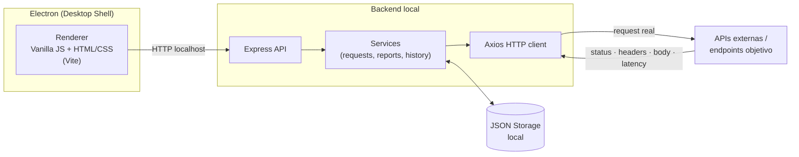
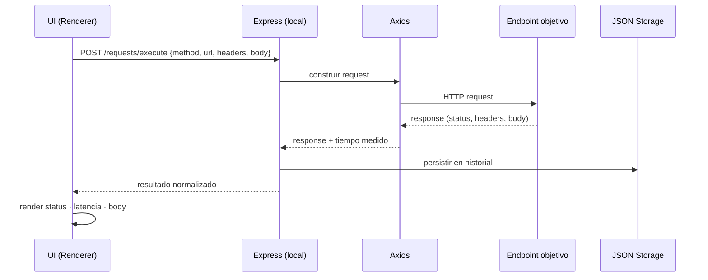
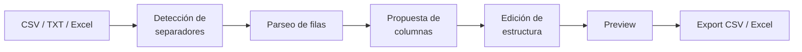
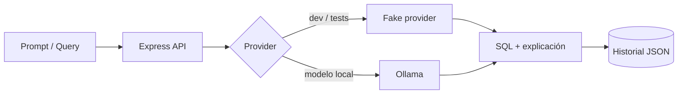

<div align="center">

# Matías Isaac Frutos González

### Full Stack Developer · Técnico Electrónico


<br>


<br>

[](https://www.matiasfrutos.site/)
[](mailto:matias.frutos@outlook.com)
[](https://linkedin.com/in/matiasfrutos)
[](https://github.com/MatiasFrutos)

</div>

---

## `whoami`

```ts
const matias = {
  role:      ["Full Stack Developer", "Técnico Electrónico"],
  location:  "Buenos Aires, Argentina",
  focus:     ["Backend (Node.js/Express)", "Desktop apps", "Automatización", "IA local", "Bases de datos"],
  background: "Hardware + software: diagnóstico, electrónica, soporte, sistemas y desarrollo",
  philosophy: "Resolver un problema real → MVP funcional → arquitectura clara → iterar",
  status:    "Construyendo, aprendiendo y mejorando todos los días",
} as const;
```

Vengo de un perfil técnico práctico (electrónica, diagnóstico, mantenimiento y soporte) y lo llevé al software: herramientas internas, paneles administrativos, utilidades para Windows, automatizaciones y aplicaciones web. Prefiero software útil, claro y mantenible antes que complejidad innecesaria.

---

## Stack técnico

| Capa | Tecnologías |
|---|---|
| **Lenguajes** |       |
| **Frontend** |      |
| **Backend** |    |
| **Datos** |    |
| **Desktop** |    |
| **DevOps / Sistemas** |      |
| **IA** |   |

### Nivel de uso (autoevaluación)

| Área | Uso | Contexto |
|---|---|---|
| Node.js / Express | Diario | APIs REST, servicios locales, CLIs |
| JavaScript / TypeScript | Diario | Frontend, backend y desktop |
| PostgreSQL / SQL | Frecuente | Modelado, consultas, paneles administrativos |
| Electron | Frecuente | Apps desktop local-first |
| Python | Frecuente | Utilidades desktop, automatización, scripts |
| Docker / VPS | En profundización | Despliegues y entornos reproducibles |
| Ollama / IA local | En profundización | Integración en flujos reales |

---

## Proyecto principal: API Watchtower

<div align="center">

[](https://github.com/MatiasFrutos/API-WATCHTOWER)


**Local-first API testing & monitoring desktop app**

</div>

Aplicación de escritorio para probar APIs, guardar historial, medir tiempos de respuesta y revisar la salud de endpoints sin cuentas, sin nube y sin configuración compleja.

```txt
Open app → Create project → Add endpoint → Send request → Review response → Check history
```

### Arquitectura



### Pipeline de una request



### Módulos

| Módulo | Responsabilidad |
|---|---|
| `Projects` | Proyectos API con nombre, base URL y descripción |
| `Endpoints` | Registro de endpoints: método HTTP, URL, headers y body |
| `Tester` | Ejecución de requests reales desde la app desktop |
| `History` | Historial local de ejecuciones |
| `Dashboard` | Resumen de proyectos, endpoints, requests y tiempos promedio |
| `Reports` | Disponibilidad, errores y rendimiento |
| `Settings` | Parámetros generales |
| `Storage` | Persistencia en archivos JSON locales |

### Stack

```txt
Electron · Vanilla JavaScript · HTML · CSS · Vite
Node.js · Express · Axios
Local JSON Storage
Electron Builder · NSIS Windows Installer
```

### Decisiones de diseño

- **Local-first:** los datos nunca salen de la máquina del usuario.
- **Vanilla JS en el renderer:** menos dependencias, arranque rápido, control total.
- **JSON como storage inicial:** valida el MVP rápido y deja la migración a SQLite como paso natural.
- **Separación renderer / backend:** la lógica de negocio vive en servicios, no en la UI.

### Roadmap

- [ ] Collections y Environments con variables
- [ ] Auth helpers
- [ ] Scheduled endpoint checks + health timeline
- [ ] Exportar reportes a PDF
- [ ] Migración a SQLite + persistencia en AppData
- [ ] Auto updates
- [ ] Asistente de IA local (Ollama) para explicar errores de API

---

## Proyectos

| Proyecto | Qué resuelve | Stack |
|---|---|---|
| [**API Watchtower**](https://github.com/MatiasFrutos/API-WATCHTOWER) | Testing y monitoreo local de APIs con historial y reportes | `Electron` `Vanilla JS` `Node.js` `Express` `JSON` |
| [**StackForge**](https://github.com/MatiasFrutos/stackforge) | IDE visual para Forth con visualización en tiempo real de la pila | `React` `Vite` `Electron` `JavaScript` |
| [**SheetPilot**](https://github.com/MatiasFrutos/SheetPilot) | Limpieza de CSV/TXT/Excel desordenados y exportación estructurada | `HTML` `CSS` `JavaScript` `Node.js` `Express` |
| [**ZERNYX File Organizer**](https://github.com/MatiasFrutos/ZERNYX-File-Organizer) | Organización de carpetas por tipo con preview y undo | `Python` `Desktop` |
| [**SQLMind Local**](https://github.com/MatiasFrutos/AI-SQL-Assistant) | Asistente SQL local: generar, explicar, optimizar y documentar | `Vanilla JS` `Node.js` `Express` `Ollama` |
| [**DevProject Starter Generator**](https://github.com/MatiasFrutos/DevProject-Starter-Generator) | CLI para scaffolding de frontend, backend, fullstack y módulos ERP/CRM | `Node.js` `CLI` `Templates` |

<details>
<summary><b>StackForge</b> · IDE visual para Forth</summary>

<br>

Herramienta educativa para entender cómo se ejecuta un lenguaje stack-based, mostrando lo que normalmente queda oculto: la pila de datos y el estado interno.

```txt
StackForge
├── Editor de código Forth
├── Intérprete en JavaScript
├── Stack Visualizer
├── Diccionario de palabras
├── REPL integrado
├── Stack Replay (ejecución paso a paso)
├── Stack DNA
└── Empaquetable como desktop con Electron
```

</details>

<details>
<summary><b>SheetPilot</b> · Limpieza de datos tabulares</summary>

<br>

Problema que resuelve: archivos exportados desde sistemas que Excel abre en una sola columna.



</details>

<details>
<summary><b>ZERNYX File Organizer</b> · Organizador de archivos</summary>

<br>

```txt
ZERNYX File Organizer
├── Seleccionar carpeta y analizar antes de mover
├── Vista previa del destino por archivo
├── Organización por categorías
├── Incluir/excluir subcarpetas
├── Carpeta organizada por fecha
├── Protección contra sobrescrituras
├── Undo del último movimiento
├── Historial
└── Abrir carpeta desde la app
```

Categorías: `Imágenes` `Documentos` `Planillas` `Presentaciones` `Comprimidos` `Videos` `Audio` `Código` `Instaladores` `Otros`

</details>

<details>
<summary><b>SQLMind Local</b> · Asistente SQL local-first</summary>

<br>

```txt
SQLMind Local
├── SQL desde lenguaje natural
├── Explicación de queries existentes
├── Optimización de consultas
├── Generación de schemas (CREATE TABLE)
├── Historial local
├── Proveedor configurable (fake local / Ollama)
└── Motores objetivo: PostgreSQL · MySQL · SQLite · SQL Server
```



</details>

<details>
<summary><b>DevProject Starter Generator</b> · CLI de scaffolding</summary>

<br>

```bash
dpsg
```

| Template | Contenido |
|---|---|
| `frontend` | Starter Vanilla JavaScript |
| `backend` | API Node.js + Express |
| `fullstack` | Frontend Vanilla JS + backend Express |
| `erp-module` | Scaffold de módulo ERP/CRM |

```txt
Validar template → normalizar nombre → copiar plantilla → reemplazar tokens → estructura final
```

</details>

---

## Principios de ingeniería

```txt
1. Entender el problema antes de escribir código
2. Construir una base funcional (MVP) antes de optimizar
3. Mantener una estructura clara y modular
4. Elegir la solución más simple que resuelva el problema
5. Documentar lo necesario, no más
6. Automatizar cuando realmente aporta valor
7. Iterar: cada versión deja una base más sólida
```

---

## Áreas de trabajo

| Área | Alcance |
|---|---|
| **Backend** | APIs REST, servicios, lógica de negocio, arquitectura server-side |
| **Frontend** | Interfaces modernas, responsive, orientadas a UX |
| **Desktop** | Apps Electron/Python/C#, herramientas internas, utilidades para Windows |
| **API tooling** | Testing de endpoints, monitoreo local, reportes técnicos |
| **Automatización** | Scripts y procesos que eliminan trabajo operativo repetitivo |
| **Sistemas** | Diagnóstico, mantenimiento y administración |
| **IA aplicada** | Asistentes y flujos con modelos locales (Ollama) |
| **Bases de datos** | Modelado, SQL, estructuras y persistencia |
| **Software de negocio** | Sistemas administrativos, ERP/CRM, paneles internos |

---

## En profundización

- [ ] Docker y despliegues en VPS
- [ ] Integración de IA local con Ollama
- [ ] PostgreSQL avanzado
- [ ] Arquitecturas backend con Node.js y Express
- [ ] Apps desktop con Electron, Python y C#
- [ ] Seguridad básica en aplicaciones web y APIs
- [ ] Testing, documentación y mejora continua

---

## Contacto

<div align="center">

[](mailto:matias.frutos@outlook.com)
[](https://matiasfrutos.site/)
[](https://linkedin.com/in/matiasfrutos)

<br>


<br>

> *"No espero tener todo perfecto para empezar. Prefiero construir, aprender, corregir y seguir avanzando."*

</div>
