<div align="center">




<br>

[](https://git.io/typing-svg)

<br>



<br>

[](https://www.matiasfrutos.site/)
[](mailto:matias.frutos@outlook.com)
[](https://linkedin.com/in/matiasfrutos)
[](https://github.com/MatiasFrutos)

</div>


## `> SYSTEM.IDENTITY`  

```txt
$ whoami --verbose

╔═════════════════════┤ matias@frutos ~/identity ├═════════════════════╗
║                                                                      ║
║  ▸ NOMBRE    │ Matías Isaac Frutos González                         ║
║  ▸ ROL       │ Full Stack Developer · Técnico Electrónico           ║
║  ▸ UBICACIÓN │ Buenos Aires, Argentina                              ║
║  ▸ FOCO      │ Backend · Desktop · Automatización · IA local · BD   ║
║  ▸ ORIGEN    │ Hardware + software: diagnóstico y soporte         ║
║  ▸ MÉTODO    │ Problema real → MVP → arquitectura clara → iterar    ║
║  ▸ STATUS    │ ● ONLINE · construyendo y mejorando cada día         ║
║                                                                      ║
╚══════════════════════════════════════════════════════════════════════╝

$ _
```

Vengo de un perfil técnico práctico (electrónica, diagnóstico, mantenimiento y soporte) y lo llevé al software: herramientas internas, paneles administrativos, utilidades para Windows, automatizaciones y aplicaciones web. Prefiero software útil, claro y mantenible antes que complejidad innecesaria.


## `> TECH.STACK`

| Capa | Tecnologías |
|---|---|
| **Lenguajes** |       |
| **Frontend** |      |
| **Backend** |    |
| **Datos** |    |
| **Desktop** |    |
| **DevOps / Sistemas** |      |
| **IA** |   |

### `> SKILL.LEVELS`

```txt
Node.js / Express        [██████████] DIARIO        APIs REST, servicios locales, CLIs
JavaScript / TypeScript  [██████████] DIARIO        Frontend, backend y desktop
PostgreSQL / SQL         [████████░░] FRECUENTE     Modelado, consultas, paneles administrativos
Electron                 [████████░░] FRECUENTE     Apps desktop local-first
Python                   [████████░░] FRECUENTE     Utilidades desktop, automatización, scripts
Docker / VPS             [█████░░░░░] EN PROGRESO   Despliegues y entornos reproducibles
Ollama / IA local        [█████░░░░░] EN PROGRESO   Integración en flujos reales
```


## `> CORE.PRINCIPLES`

```txt
01 ▸ Entender el problema antes de escribir código
02 ▸ Construir una base funcional (MVP) antes de optimizar
03 ▸ Mantener una estructura clara y modular
04 ▸ Elegir la solución más simple que resuelva el problema
05 ▸ Documentar lo necesario, no más
06 ▸ Automatizar cuando realmente aporta valor
07 ▸ Iterar: cada versión deja una base más sólida
```


## `> WORK.MODULES`

| Módulo | Alcance |
|---|---|
| ⚡ **Backend** | APIs REST, servicios, lógica de negocio, arquitectura server-side |
| 🎛️ **Frontend** | Interfaces modernas, responsive, orientadas a UX |
| 🖥️ **Desktop** | Apps Electron/Python/C#, herramientas internas, utilidades para Windows |
| 🔌 **API tooling** | Testing de endpoints, monitoreo local, reportes técnicos |
| 🤖 **Automatización** | Scripts y procesos que eliminan trabajo operativo repetitivo |
| 🛠️ **Sistemas** | Diagnóstico, mantenimiento y administración |
| 🧠 **IA aplicada** | Asistentes y flujos con modelos locales (Ollama) |
| 🗄️ **Bases de datos** | Modelado, SQL, estructuras y persistencia |
| 🏢 **Software de negocio** | Sistemas administrativos, ERP/CRM, paneles internos |


## `> LIVE.TELEMETRY`

<div align="center">

<a href="https://github.com/MatiasFrutos"></a>
<a href="https://github.com/MatiasFrutos"></a>


</div>


## `> FEATURED.PROJECTS`

<div align="center">

<a href="https://github.com/MatiasFrutos/Aurelius-IDE"></a>
<a href="https://github.com/MatiasFrutos/Morpheus-Note"></a>
<a href="https://github.com/MatiasFrutos/API-WATCHTOWER"></a>
<a href="https://github.com/MatiasFrutos/SQLMind"></a>
<a href="https://github.com/MatiasFrutos/DBPilot-Studio"></a>
<a href="https://github.com/MatiasFrutos/Port-Watcher"></a>

</div>

<details>
<summary><b>▸ Ver más proyectos</b></summary>

| Proyecto | Descripción |
|---|---|
| [**Hermes-Drop**](https://github.com/MatiasFrutos/Hermes-Drop) | Transferencia y envío rápido de archivos |
| [**Heraclitus-Trace**](https://github.com/MatiasFrutos/Heraclitus-Trace) | Trazabilidad y seguimiento |
| [**SheetPilot**](https://github.com/MatiasFrutos/SheetPilot) | Automatización de planillas |
| [**DataCleaner-Pro**](https://github.com/MatiasFrutos/DataCleaner-Pro) | Limpieza y normalización de datos |
| [**Configlens**](https://github.com/MatiasFrutos/Configlens) | Inspección de configuraciones |
| [**stackforge**](https://github.com/MatiasFrutos/stackforge) | Generación de stacks de proyecto |
| [**ZERNYX Suite**](https://github.com/MatiasFrutos?tab=repositories&q=ZERNYX) | Colección de utilidades de escritorio y sistemas |

</details>


## `> CONTRIBUTION.SNAKE`

<div align="center">

<picture>
  <source media="(prefers-color-scheme: dark)" srcset="https://raw.githubusercontent.com/MatiasFrutos/MatiasFrutos/output/github-snake-dark.svg">
  <source media="(prefers-color-scheme: light)" srcset="https://raw.githubusercontent.com/MatiasFrutos/MatiasFrutos/output/github-snake.svg">
  
</picture>


</div>


## `> LOADING...`

```diff
+ [ACTIVO]  Aprendizaje continuo
- [PENDIENTE] Docker y despliegues en VPS
- [PENDIENTE] Integración de IA local con Ollama
- [PENDIENTE] PostgreSQL avanzado
- [PENDIENTE] Arquitecturas backend con Node.js y Express
- [PENDIENTE] Apps desktop con Electron, Python y C#
- [PENDIENTE] Seguridad básica en aplicaciones web y APIs
- [PENDIENTE] Testing, documentación y mejora continua
```


## `> CONTACT.OPEN_CHANNEL`

<div align="center">

[](mailto:matias.frutos@outlook.com)
[](https://matiasfrutos.site/)
[](https://linkedin.com/in/matiasfrutos)

<br>


<br>


<br>

> *"No espero tener todo perfecto para empezar. Prefiero construir, aprender, corregir y seguir avanzando."*


</div>
